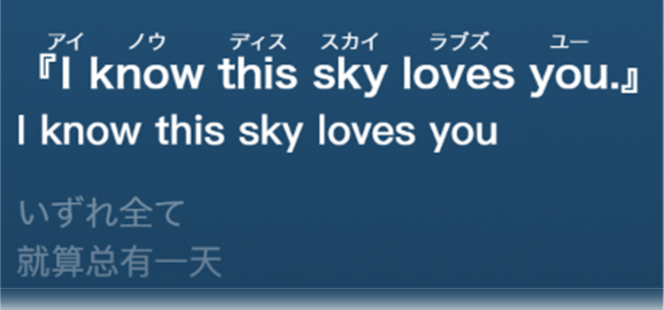

# 歌词注音 · lyric-ruby

> **这是 vibe coding 的产物**：需求一路加、以「真机上结果对」为唯一验收标准，
> 所以代码里有大量**面向结果编程**的痕迹 —— 补丁压在补丁上、按现象分支、
> 有的判据是照着某首歌的截图调出来的。它经过 427 个测试和真机验证，
> 但**不要拿它当工程范本**；发现哪里绕、哪里注释和实现不一致，欢迎直接开 issue。

给歌词标注读音：

- **日语歌词**：汉字标振假名（平假名 / 片假名），读音来自 kuromoji + IPADIC（离线）
- **西文字母**：拉丁 / 西里尔 / 希腊字母标片假名（英文、日式罗马音，法 / 德 / 拉丁 / 葡 / 西 / 荷 / 斯瓦希里 / 汉语拼音 / 俄 / 希各走各的拼读）
- **中文 / 朝鲜语歌词**：汉字按普通话读音、谚文按朝鲜语读音标片假名
- **日文字体**：日语歌的歌词可以换成日文字体（中文 Windows 上「微软雅黑」会把日文汉字画成中文写法）
- **中文多音字**（可选）：配了大模型 key 时按整句挑读音；**日语读音不走大模型**（只用词典 / 罗马音 / 网站 / 规则，可复现）



## 环境

- 网易云音乐 3.x（在 3.1.39 上实测）
- [BetterNCM](https://github.com/std-microblock/BetterNCM) 1.3.0+

## 安装

从 [Releases](../../releases) 下载 `lyric-ruby.plugin`，放进 BetterNCM 的插件目录后重启网易云。

> 从旧版 `western-katakana.plugin` 升级：先删掉旧文件再放新的（两个同时装会重复注音）；
> 配置 / 学会的词 / 用量会自动从老键搬过来。
> 装过 `jp-furigana` / `JapaneseFonts` 的可以卸掉了 —— 振假名和日文字体都已经是本插件的一部分。

自己打包：

```bash
npm ci                   # 依赖按 package-lock.json 装
npm run build            # 产出 builds/lyric-ruby.plugin
npm run install:plugin   # 顺便复制到 C:\betterncm\plugins
```

包体约 15 MB，其中 14 MB 是振假名用的 kuromoji + IPADIC 词典（`vendor/`）。
词典在第一次出现日语歌词时才读（约 0.7 秒），不拖启动。

发版：推一个 `v*` tag（`git tag v1.3.0 && git push origin v1.3.0`）会触发 CI —— 跑完 `npm run check`
与全套测试后打包，把 `lyric-ruby.plugin` 挂到 [Releases](../../releases)。

## 设置面板

面板按用途分四块，默认只显示常用的几项：

| 分区 | 内容 |
|---|---|
| 启用注音 | 总开关 |
| 读音来源 | 词典 / 外部网站（UtaTen、Uta-net）· 查询哪家 · 状态 · 重新获取 / 查看来源网页 / 手动指定歌词页 |
| 日语歌词 | 标振假名（平假名 / 片假名）· 用日文字体 |
| 其它语言 | 西文歌词标片假名（总开关）· 日语歌里夹的西文也标 · 中文歌词标普通话读音 · 朝鲜语歌词标朝鲜语读音 |
| 大模型 | 开关（只用于中文多音字）· API Key · 测试连接 |
| 预览 | 深色框里的示例歌词，字号 / 写法 / 字体一改当场变 |

「高级设置」（默认收起）里是外观（注音字号 / 不透明度 / 日文字体名 + 重置）、
范围（标注范围 / 自定义选择器 / 播放栏 / 非日语歌 / 联网校正）、
本地歌词（缓存目录 + 列表 + 删除）、接口（地址 / 模型）、读音来源顺序、API 用量、
操作（重扫 / 重试 / 导出词库 / 清缓存 / 清学会的词）。

面板顶部的「读音来源」选 **外部网站** 后，按歌名 / 歌手查 UtaTen（有振假名），
没有收录时再查 Uta-net（只有罗马音，按行对齐成读音）；命中的行用网站读音，
对不上的行照旧用词典 / 音译 / 规则。对齐放宽了两处：客户端一行比网站长（网站拆成 2~3 行）
时能对上；客户端那行带作词者的括号读音（`MY HEART(マイココロ)`）或只有网站行的前半截
（网站 `ギコギコ MY HEART 剪定`）时，也按网站标的范围注（`HEART = こころ`）。
缓存只有一个：每首歌一个
`<BetterNCM 数据目录>/lyrics/jp-furigana/<歌曲ID>.json`（格式与 jp-furigana 一致，
两个插件可共用同一份缓存；更新插件不丢，可在「高级设置 → 本地歌词」里查看 / 删除 /
「清理旧缓存」），缓存命中不联网。随时可以切回词典或「撤销网站同意」。
自动搜不到时可以「手动指定歌词页」，填 `https://utaten.com/lyric/…/` 直接读取该页。

装了 RefinedNowPlayingNext 时，它的播放页设置菜单里会多一栏「注音」
（振假名开关 / 读音来源 / 查询哪家 / 重新获取 / 查看来源网页），结构对不上就自动不显示。

## 读音怎么定

1. **先分流**：有假名的行是日文行 → 振假名；没有假名但明显是中文的行 → 中文读音；
   其余纯汉字行按整首判（整首是日语歌就当日文）。判据见 `src/core/cn-line.js`
   词典读不出的汉字有三层兜底：① 拿这个字喂「字 + 送假名」探一个一致的读音（掻く/掻き → か）；
   ② 拿页面上的**音译行**反推（`霽れを待つ君` + `ha re o ma tsu ki mi` → 霽 は），对不上就整行放弃；
   两层都不成才留白。
2. **日文行**：kuromoji 分词后取读音（`今日` きょう、`一人` ひとり、`東京` とうきょう）。
   只注汉字，送假名留在底字外面（`食べる` 只给 `食` 注 た）；作词者自己写的括号注音
   `漢字(かな)` 底字取括号前面**一整段**（汉字 + 送假名 / 西文 / 符号都算，
   `怒れる人(ラングラー)`、`HEART(ココロ)`，符号开头逐字层拆开的 `〆（シメ）` 也认），
   读音照原样显示（片假名就出片假名，不跟面板的平假名设置）；叠字符 `々` 跟着前一个字读（`星々` ほしぼし）
   **外部网站**打开后，UtaTen 命中行的读音压过词典 / 音译；用户双击改过的读音永远最优先
3. **西文**：按四层顺序取 —— 离线词典（6895 条）> 日式罗马音 > 免费接口 > 英文音译规则，
   顺序可在高级设置里调。记号（`D/N/A` / `R&B`）、缩写（`I'll` / `don't`）、不发音字母（`knock` ノック）都单独处理
4. **中文 / 朝鲜语**：汉字查 20856 字的普通话读音表（配了 key 时多音字可由大模型按整句挑候选）；谚文按朝鲜语规则现拼

读音取不到时留白，不猜。

## 怎么调

设置面板（歌词页右上角的齿轮）：「高级设置 → 操作 → 重置本首读音」清掉这一首里
"就地改过的读音"，回到词典读音（面板规则 / 别的歌都不动）。
歌词页上不再挂按钮 —— 那一栏是 RNP 的地盘，会被它重建掉。

双击一个注音可以就地改读音（**汉字、西文词都一样**）：回车保存；**清空输入框 = 恢复词典读音**；
输入 `-` = 这一处不注音；输入斜杠 = 按字切词（`あざ/わら`、`-/わら`、`あざ/`）。
有多个常用读法的词（`明日` / `行く` / `抱く` / `解く` / `何` / `良` / `皆` / `泥水` / `泡沫` / `灯` / `弄る` …）
和数字（`4` よん/し、`7` なな/しち、`四` し/よん…）双击时下面会列一排候选（词典里这个写法的所有读法），
点一下直接切，编辑器不关，可以接着点另一个比较。
编辑器两边的 ← / → 把相邻那个注音并进来（`辛`+`辛` → `辛辛` からがら、`日`+`々` → `日々` ひび）。

## 已知限制

- 只标网页里的歌词（播放页 / 歌词栏 / 逐字歌词）；桌面歌词是原生窗口，改不到
- 中文翻译层、罗马音层、制作信息与版权行一律跳过
- 振假名的读音依赖 IPADIC：生僻字、造词、纯英文夹杂处可能留白
- 日语歌里的中文行按普通话读音注；日文和中文都会写的字（比如 `愛`）在纯汉字行里可能判错

## 开发

```bash
npm run check        # 静态自检（ES5 / manifest / 注入顺序 / 词典完整性 / 密钥）
npm test             # 全套测试
npm run build:dict   # 重新生成西文读音词典
npm run build:hanzi  # 重新生成普通话读音表
```

读音来源、判据与实现要点见 [docs/notes.md](docs/notes.md)。

## 许可

插件自身的代码采用 MIT，见 [LICENSE](LICENSE)。

外部网站读音（UtaTen / Uta-net）的方案参考 [jp-furigana](https://github.com/Leleawa/jp-furigana)（MIT）；
歌词与读音的著作权属于权利人及相应网站，程序化获取仅限个人学习。

常用汉字的音读 / 训读表（`src/core/kanji-readings.js`）由
[davidluzgouveia/kanji-data](https://github.com/davidluzgouveia/kanji-data)（MIT）的常用漢字数据生成，
原始 JSON 在 `tools/vendor/kanji/`，重新生成用 `node tools/build-kanji-readings.js`。

第三方组件（kuromoji / IPADIC / furigana.js，以及 JapaneseFonts 的字表与字体默认值）与数据来源见 [NOTICE.md](NOTICE.md)。
